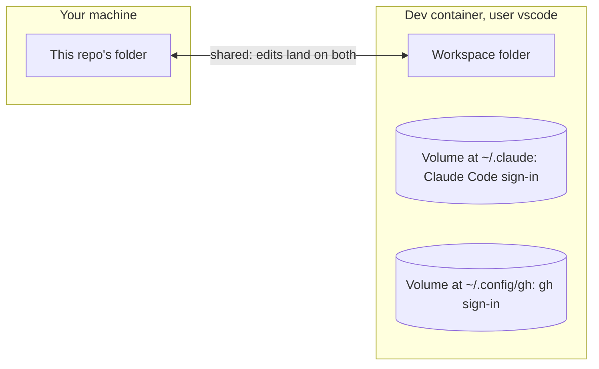

# The dev container

A Linux container to run the factory and the loop in. It has Python 3.12, git, tmux, Node, the GitHub CLI and Claude Code, and runs as the non-root `vscode` user. It takes nothing from your machine but this repo's folder: no SSH keys, no cloud credentials, no sign-ins.

Alt text: your machine shares one folder, this repo's workspace, with the container through a bind mount, and edits on either side land on both. The container also has two named volumes of its own: one at /home/vscode/.claude holding Claude Code's sign-in, and one at /home/vscode/.config/gh holding the GitHub CLI's. Nothing else on your machine reaches the container.



## Open it

- In VS Code, with the Dev Containers extension: open this folder and run **Dev Containers: Reopen in Container** from the command palette.
- From a terminal, with the `devcontainer` CLI: run `devcontainer up --workspace-folder .` in this folder, then `devcontainer exec --workspace-folder . bash` to get a shell.

The first build takes a few minutes. When it finishes, it points git at `.githooks` and runs `python3 scripts/check_setup.py`, whose output says what's still to set up.

## Sign in

Inside the container, run `claude` and follow its sign-in, then run `gh auth login`. Claude Code keeps its sign-in in `/home/vscode/.claude` and the GitHub CLI in `/home/vscode/.config/gh`. Both are named volumes that belong to this container, so they survive a rebuild. They aren't your machine's sign-ins, and no other project's container shares them. To sign out for good, delete the two volumes: `docker volume ls` lists them as `claude-code-config-…` and `gh-config-…`.

## The workspace

The workspace folder is shared with the host, so edits land there: a file changed inside the container is changed on your machine, and the other way round. Commits and branches made inside land in the same repo.

## The loop's sandbox

On macOS the loop runs `test_command`, `generate_command` and `setup_command` inside `sandbox-exec`. Linux has no `sandbox-exec`, so in the container they run without it, and the loop's log says so in one `WARN` line when a run starts:

```
test_command, generate_command and setup_command run without a sandbox here, since only macOS has sandbox-exec: they can read any file your user can
```

In the container, "any file your user can" means what the next section lists.

## What the container doesn't stop

It keeps your machine's credentials out. It doesn't limit what runs inside it. Anything running in the container, whether an agent, a test command or a dependency's install script, can:

- read the Claude Code and GitHub CLI sign-ins in its two volumes, and act as you on GitHub with whatever access `gh auth login` gave it;
- read and change every file in the shared workspace, `.git` included, and so the same files on your machine;
- reach any address on the network. There is no egress firewall, so it can send what it reads anywhere.
