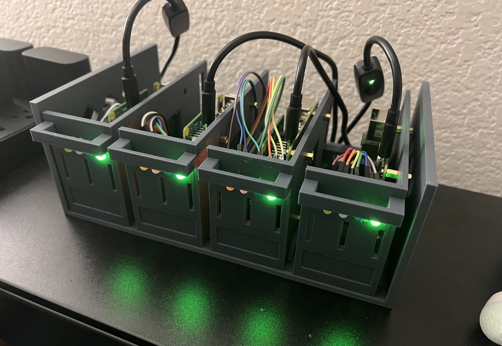
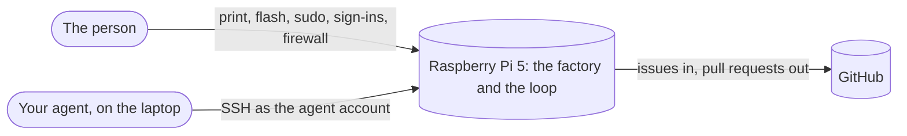
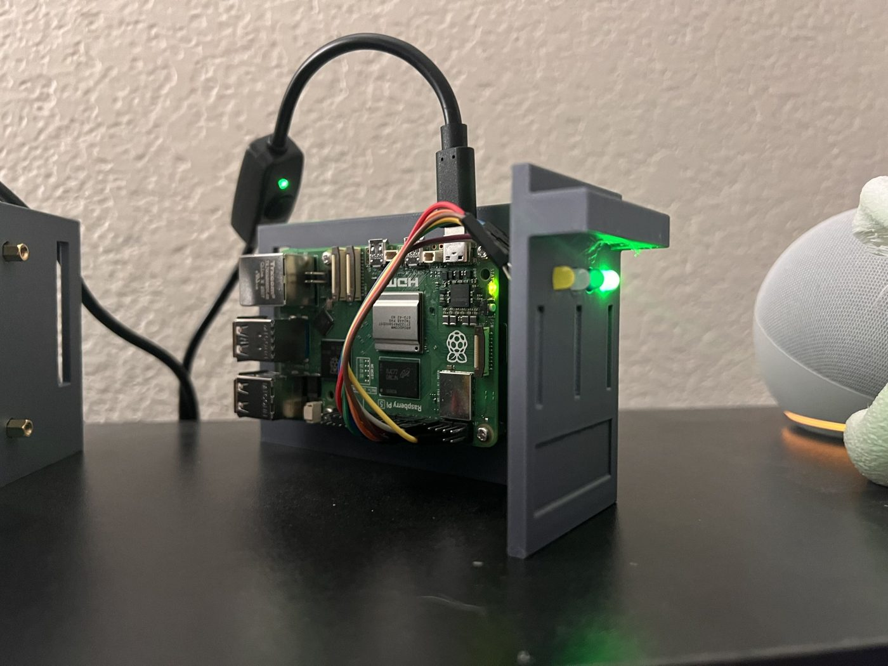
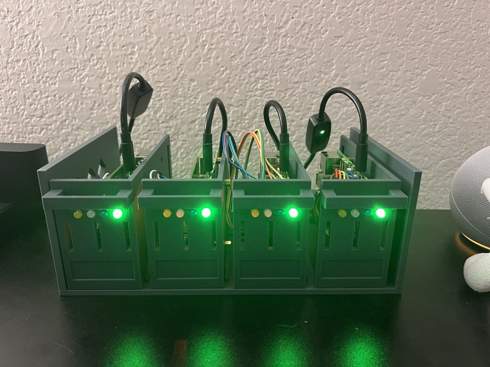

# Set up a Raspberry Pi builder

This is the procedure an agent follows when a person asks it to set up a
Raspberry Pi 5 as a builder: a machine that runs [`scripts/loop.py`](../scripts/loop.py) on one
repo, turning issues labelled `loop-ready` into reviewed pull requests while
their laptop is closed. Run it from a coding-agent session on the person's
laptop. Follow the steps in order. Show the person each command before you run
it, and stop wherever a step says to.

The Pi doesn't run the model. It runs the factory and the coding tools, and
they call the model over the network, so a Pi 5 with 8 GB is enough.





*The person does the physical steps and everything that needs a password, a
login or a token. You reach the Pi over SSH, as an account with no sudo, and
do the rest. The Pi talks to GitHub and to the model, and nothing else needs to
reach it.*

## Who does what

| The person does | You do |
|---|---|
| Print the stand and assemble the Pi | Check the Pi gets full power |
| Flash the card | Install the tools in the agent account |
| Anything that needs `sudo` without `sudo -n` | Clone the factory and run its setup check |
| Sign the agent in to Claude, and to GitHub with a token they create | Clone the project and write its `loop.json` |
| The firewall | Run the loop dry and read what it says |
| Label the first issue and start the loop | Hand over the commands for that |

Never ask for a password or a token, and never ask the person to paste one into
this session. Where a step needs one, they type it in their own terminal.

## 1. Ask before anything runs

Ask the person for:

- the Pi's hostname, `<host>` (say `shop`), and their admin user on it, `<admin>`
- the repo it builds, `<owner>/<repo>`, and a short name for it, `<name>`
- the command that runs that repo's tests, `<test>` (say `npm test`)
- the name and email the agent's commits carry

Run nothing until you have all four.

## 2. The person builds and flashes it

Stop here and give the person this list. Go on only when they say the Pi is up.

- **The parts:** a Raspberry Pi 5, the Active Cooler, the official 27 W USB-C
  supply, and optionally an M.2 HAT+ with a small NVMe drive. An SD card is fine
  to start.
- **The stand:** [Raspberry Pi 5 four-bay stand with LED carriers](https://makerworld.com/en/models/3679779-raspberry-pi-5-four-bay-stand-with-led-carriers)
  on MakerWorld, or any case.
- **The power:** the official supply plugged straight into the Pi, with no
  adapter between. A right-angle USB-C adapter blocked power negotiation on one
  of ours, and it browned out until the adapter came off.
- **The card:** Raspberry Pi Imager, Raspberry Pi 5, then Ubuntu Server 24.04
  LTS (64-bit). In its settings: hostname `<host>`, user `<admin>`, SSH on with
  their public key, and their WiFi if there's no cable. No token and no AI login
  goes on the card.
- **First contact:** they run `ssh <admin>@<host>.local` once themselves and
  accept the host key, so you never accept one for them.

What they're building, in order: the printed stand, one Pi bolted to its
carrier, and the carriers slid into the stand.






## 3. Check you can reach it, and that it has power

```bash
ssh -o BatchMode=yes <admin>@<host>.local true
ssh -o BatchMode=yes <admin>@<host>.local 'od -An -tu4 --endian=big /proc/device-tree/chosen/power/max_current'
```

If the first fails, stop and tell the person: the host key wasn't accepted, or
the hostname doesn't resolve. The second should print `5000`. Anything lower
means the supply isn't negotiating full power. Stop and send them back to the
power item in step 2.

## 4. The agent account

The loop's agents run commands, so they get an account with no sudo. It can't
install system software, change the firewall or read the admin's files. It can
still reach the network and whatever its own logins reach.

These need sudo. Check whether the admin has it without a password:

```bash
ssh -o BatchMode=yes <admin>@<host>.local 'sudo -n true'
```

If that exits 0, run the block below over SSH. If it doesn't, show the block to
the person and have them run it in their own terminal, after
`ssh <admin>@<host>.local`:

```bash
sudo adduser --disabled-password --gecos "" agent
sudo apt update && sudo apt install -y git tmux python3 gh curl
sudo install -d -m 700 -o agent -g agent /home/agent/.ssh
sudo install -m 600 -o agent -g agent ~/.ssh/authorized_keys /home/agent/.ssh/authorized_keys
```

The last two let the person's key log in as `agent`, which is how you work from
here on. Check it:

```bash
ssh -o BatchMode=yes agent@<host>.local 'id; sudo -n true 2>/dev/null && echo HAS-SUDO || echo no-sudo'
```

`agent` with `no-sudo` is right. `HAS-SUDO` means the account is wrong: stop and
tell the person. `Permission denied (publickey)` on a Pi whose SSH someone has
hardened usually means `AllowUsers` names only the admin: the person checks
`sudo sshd -T | grep -i allowusers` and adds `agent` to it, or tells you to run
the rest through `ssh -t <admin>@<host>.local sudo -iu agent` instead.

## 5. The firewall is the person's

Never run this yourself. A wrong network range locks them out of the Pi. Show
them the block, with their own range in place of the example, and tell them to
open a second SSH session before closing the first:

```bash
sudo ufw allow from 192.168.1.0/24 to any port 22 proto tcp
sudo ufw enable
sudo ufw status
```

Go on when they say the second session connected.

## 6. The agent's tools

From here, everything runs as `agent`:

```bash
ssh agent@<host>.local 'curl -fsSL https://claude.ai/install.sh | bash'
ssh agent@<host>.local 'curl -LsSf https://astral.sh/uv/install.sh | sh'
ssh agent@<host>.local 'bash -lc "claude --version && uv --version"'
```

Both versions should print. The installers put them in `~/.local/bin`, which a
login shell finds and a plain one doesn't, so keep `bash -lc` in the commands
that use them.

## 7. The person signs the agent in

Stop and hand these to the person. They type the logins in their own terminal:

- **Claude:** `ssh -t agent@<host>.local 'bash -lc claude'`, then log in, then
  exit. Codex or Kiro the same way, if they use them.
- **GitHub:** a fine-grained token on github.com, limited to `<owner>/<repo>`,
  with read and write on contents, issues and pull requests, and a short expiry.
  Then `ssh -t agent@<host>.local 'gh auth login --with-token'`, paste it, and
  press Ctrl-D.

When they say both are done, check, reading only exit codes:

```bash
ssh agent@<host>.local 'gh auth status >/dev/null 2>&1; echo $?'
ssh agent@<host>.local 'gh auth setup-git && gh repo view <owner>/<repo> --json name -q .name'
```

`0`, then the repo's name. Anything else, stop and say which one failed. Then
set the identity the person gave in step 1:

```bash
ssh agent@<host>.local 'git config --global user.name "<their name>" && git config --global user.email "<their email>"'
```

On a headless Pi, `gh` keeps the token in a file only `agent` can read. That's
why it's scoped to one repo and expires soon.

## 8. The factory

```bash
ssh agent@<host>.local 'git clone https://github.com/SanvioLabs/sanvio-factory.git factory'
ssh agent@<host>.local 'cd factory && git config core.hooksPath .githooks && bash -lc "python3 scripts/check_setup.py"'
```

Show the person the whole output. On a fresh Pi copy three warnings are
expected: `remote:`, `company:` and `mods:`, as [`INSTALL.md`](../INSTALL.md) step 4
explains. If `mods:` says `claude isn't on PATH`, the check ran outside a login
shell: keep the `bash -lc`. Run none of the commands their notes name. On any FAIL, stop and show
that line.

## 9. The project and its tests

```bash
ssh agent@<host>.local 'cd factory && git clone https://github.com/<owner>/<repo>.git projects/<name>'
ssh agent@<host>.local 'cd factory/projects/<name> && printf "%s\n" "{\"test_command\": \"<test>\"}" > loop.json && cat loop.json'
ssh agent@<host>.local 'cd factory/projects/<name> && bash -lc "<test>"'
```

The tests have to pass on the Pi before the loop gets the project. If they need
packages only sudo can install, list them for the person and stop. On Linux the
loop runs `<test>` without a sandbox, so it can read anything `agent` can.

## 10. Run the loop dry

```bash
ssh agent@<host>.local 'cd factory && bash -lc "python3 scripts/loop.py run --project projects/<name> --dry-run --once"'
```

Read the log:

- `IDLE nothing ready`: it can see the repo and nothing is labelled yet. Done.
- It names an issue it would take: done, and the person has already labelled
  one.
- `could not list issues`: `gh` isn't signed in for `agent`. Back to step 7.

## 11. Hand it over

The setup stops here. You don't label an issue or start the loop. Tell the
person:

- Label one small issue `loop-ready` on `<owner>/<repo>`. Small means a change
  they could review in ten minutes.
- Start the loop in its own tmux server, so a second loop on the same Pi later
  doesn't stop it:

  ```bash
  ssh -t agent@<host>.local
  tmux -L <name> new -s <name>
  cd factory && python3 scripts/loop.py run --project projects/<name>
  ```

  Then `Ctrl-b d` to leave it running, and `tmux -L <name> attach` to look in.
- It plans, builds, tests, has a second agent review, and opens a pull request.
  Five rounds, then it asks a person. It never merges unless they turn on
  `auto_merge` in `loop.json`.

From then on, a session opened in `factory/` on the Pi has the factory's own
skills: `loop-control` starts, stops and explains the loop, and
`/orientation` sets the factory up for their company.

## What this doesn't do

- **The front lights.** The carriers have holes for four LEDs: network, disk,
  the loop and the AI. [`examples/pi-lights/`](../examples/pi-lights/) has the wiring, the boot config
  and a service that drives them, all run by the person since they need sudo.
- **Survive a reboot.** The loop runs in tmux. A systemd service owned by
  `agent` is the next step once they trust it.
- **A private copy of the factory.** [`INSTALL.md`](../INSTALL.md) step 5 covers it, and it
  applies here before they push anything of their own.
- **Boot from NVMe.** That's a change to the Pi's boot order, in Raspberry Pi's
  own documentation.
