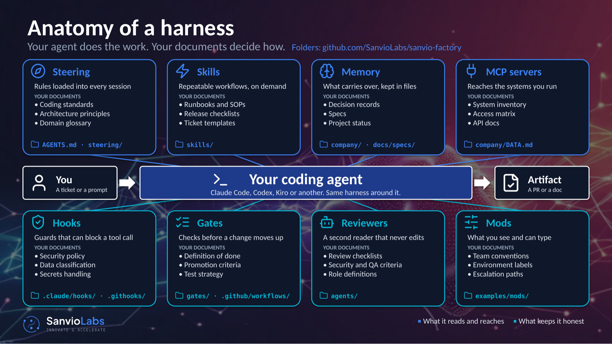

# Workshop

The Sanvio Factory workshop, written so you can run it yourself. It takes you
from a fresh clone to one real piece of your own work turned into a pull request
you read and merged, with a check that blocks the mistake the agent made on the
way. About three hours, on your own or with one other person.

| File | What it is |
|---|---|
| This page | The walkthrough: the deck's sections in order, what each one is saying, and what to do before you move on |
| [`workshop-deck.pdf`](workshop-deck.pdf) | The deck, 33 slides. Page numbers below point into it. The animated slides show their first frame here; the animations are on this page |
| [`onboarding-cards.pdf`](onboarding-cards.pdf) | Six one-page cards, one per session, from the first commands to a loop that runs without anyone driving it. Each ends with what to do before the next |
| [`../../EXERCISES.md`](../../EXERCISES.md) | The hands-on steps the sections below send you to |

Read a section here, flip through its slides, do what it asks, and only move on
once you've reached its finish line. Presenting it to your team instead? Use the
PDF as the slides and this page as your script.

## Before you start

About 20 minutes.

1. **Claude Code on a business or team plan.** On a personal plan, use
   invented data only. A personal plan can leave training on your data to a
   setting; a business plan puts it in the terms.
2. **Clone the factory and run the setup check:**

   ```bash
   git clone https://github.com/SanvioLabs/sanvio-factory my-factory && cd my-factory
   git config core.hooksPath .githooks
   python3 scripts/check_setup.py
   ```

   Don't skip the middle line. Without it the commit checks never run, and
   nothing tells you.
3. **Make your clone a private sandbox** the loop can write to. GitHub won't
   make a private fork of a public repo, so don't use Fork. From inside
   `my-factory`:

   ```bash
   git remote rename origin upstream
   gh repo create my-factory --private --source=. --remote=origin --push
   gh label create loop-ready
   gh label create loop:blocked
   ```

   Never point the loop at a production repo.
4. **Pick one place your team's standards live**: a single wiki space or
   folder, not the whole wiki. It should hold how you work, not customer
   records.
5. **Pick one small, real task**: a bug, a doc fix, a small feature. Small
   enough to finish in one loop run, and something a test can check.

## The five finish lines

Slides 1 to 3. Each section below ends at one of these. Tick them off as you go.

| | Finish line |
|---|---|
| Your clone | The setup check passes, on your account, and you're its owner |
| Your knowledge | It answers a question from your docs and names the page |
| Your skill | One procedure you already run, written as a skill, plus one borrowed skill reviewed before it came in |
| Your first motion | Your task went from a ticket to a pull request, and you read and merged it |
| Your first gate | One check that blocks a mistake your agent made during the workshop |

## 1. Why a factory

Slides 4 to 8, about 10 minutes. Nothing to do yet but read.

The model is the engine. The factory is everything around it that holds it to
your rules. Same request, same model, twice: on its own, the agent leaves a rate
as TBD and it goes out. With the harness around it, a gate stops it, the rate
comes from the rate card, a reviewer reads it as the customer would, and only
then does it go out.


The top row is what a session reads and reaches: steering, skills, memory, and
the systems it connects to. The bottom row keeps it honest: hooks, gates and
reviewers. Each box is fed by a document your company probably already has.
Before you go on, write down which of them you already have. That's where you
start.



The factory is everything between sessions. One issue goes in, labelled for the
loop. A fresh agent plans it, another builds it in its own worktree, the script
runs your tests, a second agent reviews the diff, and it opens a pull request. A
person merges it. What went wrong goes into lessons the next run reads.


You hold the levers. Each step either waits for a person or runs on its own,
and most teams start with every step waiting and let go of one once its check
catches what the person would have. Today, every step waits.

## 2. Your own clone

Slides 9 to 11, about 15 minutes. [Card 1](onboarding-cards.pdf) goes with it.

If you did *Before you start*, this is a check. Start Claude Code from the repo
root and trust the folder: started anywhere else, the rules, guards and skills
don't load. The line above the prompt names each part of the harness as it
acts, so you can watch it work.

It runs on your account. Nothing of yours passes through anyone else's tooling,
and anything near your code or data belongs on a business or team plan.

**Finish line:** `python3 scripts/check_setup.py` passes, or every line it
leaves names a fix you've decided to make later.

## 3. Connect your knowledge

Slides 12 to 15, about 30 minutes. [Card 2](onboarding-cards.pdf), first half.

Before it builds anything, it should know how you work. This is usually the
moment it first says something only your company knows.

Connect one source, the safe way:

- **One named space**: the one with the standards people actually look things
  up in, like engineering standards, the release checklist or the support
  playbook.
- **Read-only, through your own connector**: the wiki or drive tool you already
  use. `/mcp` in Claude Code shows what's connected and adds what isn't.
- **One row in `company/DATA.md`**: where it lives, how it's reached, whether
  it's cleared. Run `/orientation` and it drafts the row. It never logs in for
  you.

What never goes in: customer or end-user records, credentials (refer to them by
name, never paste them), anything regulated until your contract says it can,
and correspondence with third parties. If a space mixes standards with records,
pick a narrower one.

**Finish line:** ask two questions. One your docs answer, where it names the
page. One they don't, where it says it can't find it. A right answer with no
page named doesn't count, because it guessed. The second question matters
more: you're checking it says "I can't find it" rather than inventing
something.

## 4. Skills

Slides 16 to 18, about 25 minutes. [Card 2](onboarding-cards.pdf), second half, and
[EXERCISES.md](../../EXERCISES.md) step 2.

A skill is one procedure you run the same way every time, written down so the
agent runs it the same way too. It has four parts: a name, a description that
says when to use it, numbered steps, and a defined output. If you can't say
what the output is, it isn't a skill yet.

Copy [`examples/proposal/skills/draft-proposal/`](../../examples/proposal/skills/draft-proposal/) and rewrite it for a job you do
every week: a status update, a release note, a code review, a support reply.

A borrowed skill is someone else's instructions running with your permissions,
so it gets reviewed before it comes in. Run `/review-skill` on one public skill.
It reads every file without running any of it, and sorts what it finds into
covered (you already have this), gap (adopt it, in your own conventions) and
conflict (it fights a rule you have). Adopt the gaps, never the whole file.

**Finish line:** your skill is committed, and one borrowed skill has been
through `/review-skill`.

Slide 19 is a break. Take it, and settle on the task you'll run next.

## 5. Your first motion

Slides 20 to 23, about 45 minutes. [Card 3](onboarding-cards.pdf) goes with it.

One real ticket, end to end, on your sandbox repo:

1. Write it: `/stelliad:create-ticket`.
2. Grade it: `/stelliad:review-ticket` says READY, or exactly what's missing.
   NEEDS_REFINEMENT is a good result: fix what it names and grade it again.
3. Label it `loop-ready`, or say "put #12 on the loop". The label is the gate.
4. The loop plans, builds, tests and reviews it.
5. It opens a pull request.

Start it with `python3 scripts/loop.py run`, and watch it with
`tail -f .loop/loop.log` or `/factory-floor`. Slide 22 is a real run: plan,
build, tests and review, and a pull request open in under two minutes.

The loop merges nothing on its own. Auto-merge exists, but it's off until the
factory's owner turns it on with `auto_merge` in `loop.json`, and even then it
only merges work its own review graded high enough, by trusted authors, with
every check passed. Leave it off.

Read the pull request the way a reviewer would: the plan (did it understand the
ticket?), the diff (is this the change you'd have made?), the tests (do they
prove the change, or only that the code runs?), and the second agent's review
(what did it flag, and was it right?).

**Finish line:** you merged it, or sent it back with a reason. Write down
everything you had to fix by hand. It's the input to the next section.

## 6. Your first gate

Slides 24 to 27, about 20 minutes. [Card 4](onboarding-cards.pdf), and
[EXERCISES.md](../../EXERCISES.md) steps 3 and 4.

A correction said out loud lasts one conversation. A rule written into the file
lasts every session after. Say "learn from that" when it gets something wrong,
and `/learn` writes the rule into the file that governs it, dated, with the
reason.


A rule is context: the agent reads it, and can still skip it. A gate is
enforcement: a script that fails when the work isn't ready. Slide 26 is the
example gate in [`examples/proposal/gates/`](../../examples/proposal/gates/) refusing a commit whose rate
isn't the rate card's.

Take one thing from your list of hand fixes. Write a gate that blocks it, date
it and write why, wire it into the hook, then try to commit something that
should fail.

**Finish line:** the commit is refused, and the message says what to fix. A
check that doesn't block is decoration.

## 7. What comes next

Slides 28 to 33.

You've done the first five steps of eight:

1. The factory in your own environment, on your account, owned by you
2. Your knowledge connected, and checked that it can read it
3. Skills that match work you already do, each reviewed before it comes in
4. One small real task taken end to end
5. Gates added where the agent actually went wrong
6. Specs: feature-level work, built from your own notes. [Card 5](onboarding-cards.pdf)
7. Your team: one person first, then everyone, improving each sprint. [Card 6](onboarding-cards.pdf)
8. Your own loop: tickets in, built, tested and reviewed, with a person at the end

The loop turns the same five phases once per issue: the ticket is Discover, the
plan and the label are Shape, the build is Build, tests and review are
Validate, the merge and the lessons are Scale. The lessons are the step that
gets skipped, so read `.loop/lessons.md` at every sprint review.


Before you close the laptop, write down the next step you'll take and the date
you'll take it. Card 1's *Before card 2* list is a good place to start.

## Keeping it current

[`onboarding-cards.html`](onboarding-cards.html) is the cards' source, and [`onboarding-cards.pdf`](onboarding-cards.pdf) is
built from it. Edit the HTML, then rebuild the PDF so the two match:

```bash
"/Applications/Google Chrome.app/Contents/MacOS/Google Chrome" --headless --no-pdf-header-footer \
  --print-to-pdf="$PWD/docs/workshop/onboarding-cards.pdf" "file://$PWD/docs/workshop/onboarding-cards.html"
```

Any Chromium browser works; on Linux it's `chromium --headless` with the same
flags. Keep each card to one letter page: the PDF should have seven.

The deck's source is kept with Sanvio Labs' presentations, outside this repo,
and [`workshop-deck.pdf`](workshop-deck.pdf) is built from it. To change a slide, open an issue
saying which page and why.

When a skill is added, renamed or removed, check this page, the cards and the
deck name it the way the repo does.
