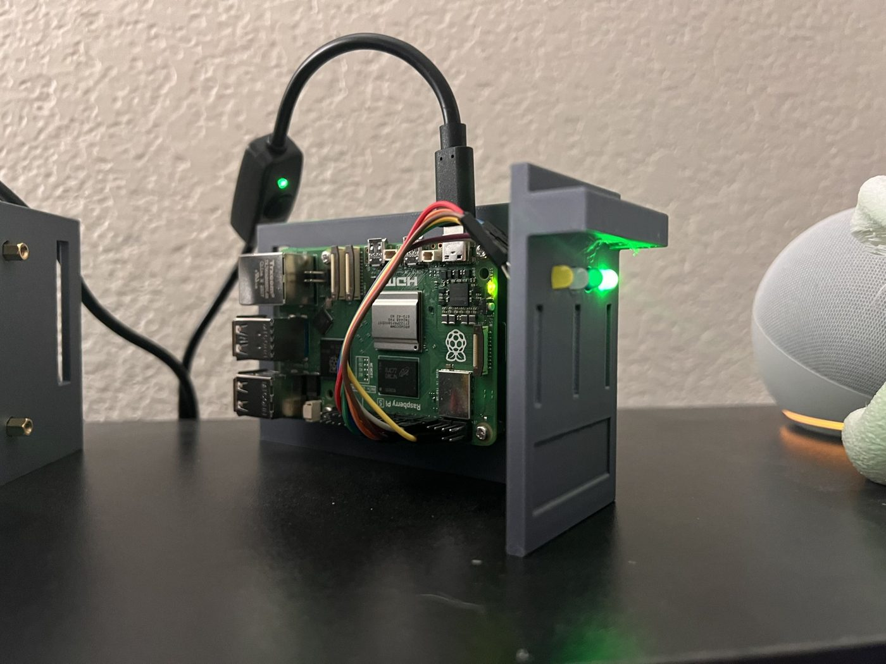

# Front lights for a Raspberry Pi builder

Four LEDs on the front of a [Pi builder](../../docs/pi-builder.md), so you can
see from across the room which Pi is busy and with what. The carriers in the
[four-bay stand on MakerWorld](https://makerworld.com/en/models/3679779-raspberry-pi-5-four-bay-stand-with-led-carriers)
have the four holes for them.



| Light | Colour | Shows | GPIO | Header pin |
|---|---|---|---|---|
| `pi-net` | green | on while the network is up, flickering while traffic moves | 17 | 11 |
| `pi-disk` | blue | flickers while the drive reads or writes | 22 | 15 |
| `pi-loop` | orange | flickers while the factory's loop works an issue | 27 | 13 |
| `pi-ai` | white | flickers while a `claude` process runs as the agent account | 23 | 16 |

[`pi_lights.py`](pi_lights.py) drives all four, dimmed in software to 8% of full,
because a clear 5 mm LED is too bright head-on. It reads the loop's status
files, the drive's and the network's counters and the process list, and writes
only the four lights. [`pi-lights.service`](pi-lights.service) runs it at boot.
It needs Python 3 and nothing else.

## Wire them

Each LED wires the same way: a GPIO pin, then the resistor, then the LED's long
leg, and its short leg to a ground pin. Grounds are on header pins 9, 14, 20
and 6. Use 330 Ω for green and orange, and 100 to 150 Ω for blue and white,
which need more voltage to light. Female-to-female jumper wires push onto the
header and the LED's legs.

Wiring can wait. Nothing below breaks without the LEDs in place.

## Install

These need sudo, so the admin account runs them, not the agent account.

1. **Name the four pins.** Add these lines to the end of
   `/boot/firmware/config.txt`, then reboot:

   ```
   [all]
   dtoverlay=gpio-led,gpio=17,label=pi-net
   dtoverlay=gpio-led,gpio=22,label=pi-disk
   dtoverlay=gpio-led,gpio=27,label=pi-loop
   dtoverlay=gpio-led,gpio=23,label=pi-ai
   ```

   After the reboot, `ls /sys/class/leds` lists `pi-net`, `pi-disk`, `pi-loop`
   and `pi-ai`.

2. **Check each LED.** From a copy of this folder:

   ```bash
   sudo python3 pi_lights.py --test
   ```

   It lights green, blue, orange, then white, a second and a half each. One that
   stays dark is wired backwards or to the wrong pin.

3. **Install the service:**

   ```bash
   sudo install -D -m 755 pi_lights.py /usr/local/lib/pi-lights/pi_lights.py
   sudo install -m 644 pi-lights.service /etc/systemd/system/pi-lights.service
   sudo systemctl daemon-reload
   sudo systemctl enable --now pi-lights
   ```

   The service follows the factory at `/home/agent/factory` and the `agent`
   account, as the [Pi builder guide](../../docs/pi-builder.md) sets them up.
   If yours differ, change `--factory` and `--user` in the service file before
   you install it.

## Check what it sees

```bash
python3 pi_lights.py --show
```

No sudo, and it touches no light. Once a second it prints what each light
would show, such as `net busy  disk idle  loop 1  ai on`. Ctrl-C stops it.
`loop` is the number of issues the loop is working right now.

## Change it

| Option | Default | Does |
|---|---|---|
| `--level` | `0.08` | Brightness from 0 to 1. `1` turns dimming off |
| `--blink` | `0.1` | Seconds per flicker of the loop and AI lights. `0` holds them steady |
| `--iface` | the default route's | The network interface the green light follows |
| `--dev` | NVMe, else the SD card | The drive the blue light follows, such as `nvme0n1` |
| `--labels` | `pi-net,pi-disk,pi-loop,pi-ai` | The four lights' names, in that order, if your overlay names them differently |

The white light is on while any `claude` process runs as the agent account,
which on a builder means while the loop has an agent at work. A session you
leave open there keeps it on too.
